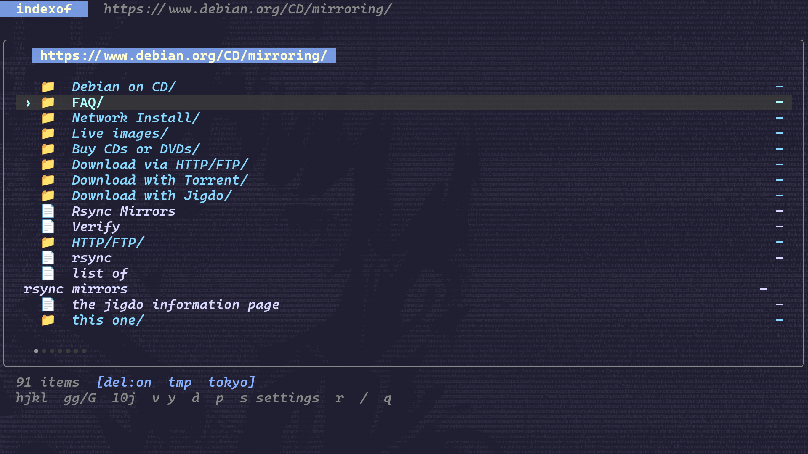
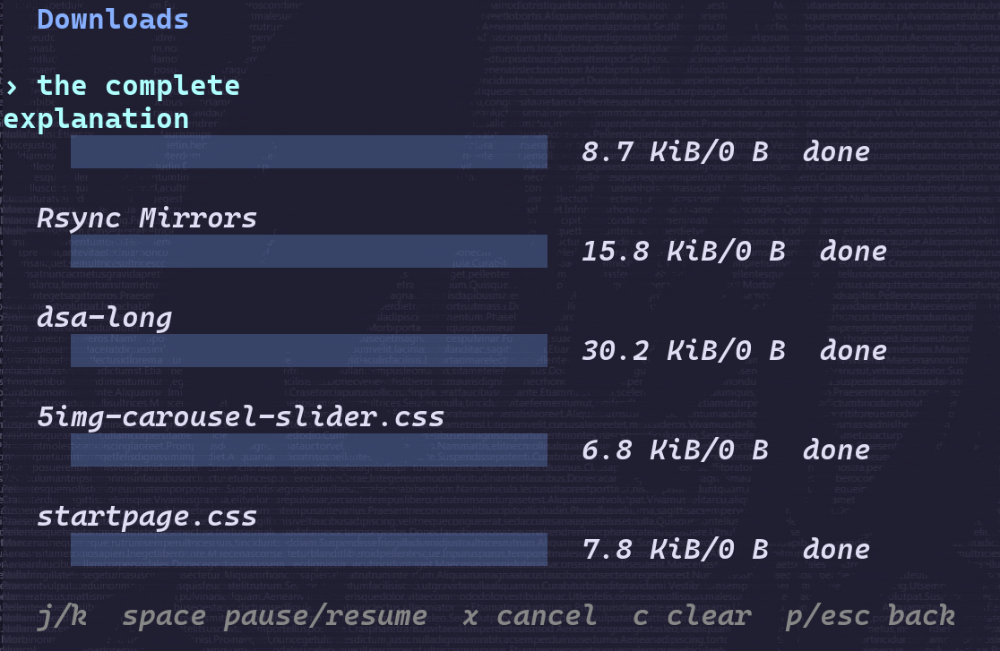
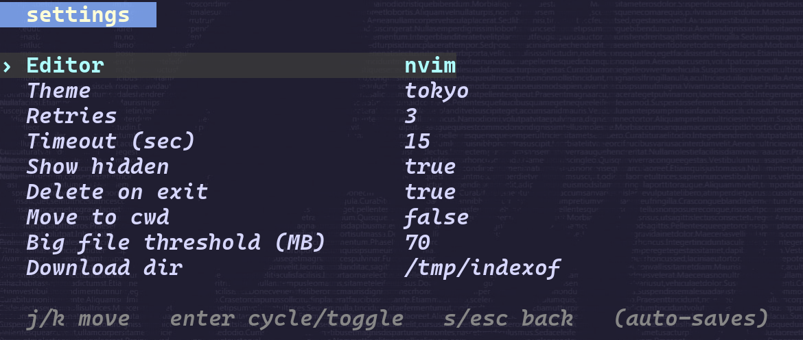
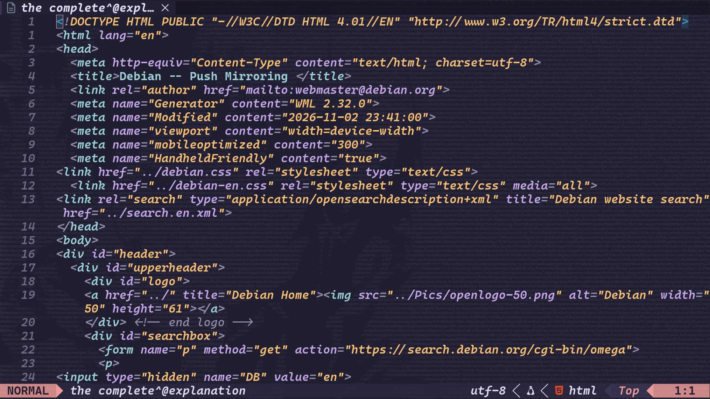

# indexof

a terminal browser for open directories. browse files, download what you need, or open them in your editor.

[install](#install) · [screenshots](docs/showcase.md) · [usage](docs/usage.md) · [config](docs/configuration.md)

[](docs/images/browser.png)

## Features

- vim-style movement, including counts like `10j`
- visual selection for copying multiple urls
- background downloads with pause, resume, and cancel
- open downloaded files in your editor
- six themes and settings that save automatically

<table>
  <tr>
    <td width="50%" valign="top">
      <a href="docs/images/downloads.png"></a>
      <br><strong>Downloads</strong><br>press <code>p</code> to check progress or manage a download.
    </td>
    <td width="50%" valign="top">
      <a href="docs/images/settings.png"></a>
      <br><strong>Settings</strong><br>press <code>s</code>, pick an option, and hit <code>enter</code> to change it.
    </td>
  </tr>
</table>

## Install

you'll need go 1.22 or newer and an editor on your `PATH`. the default is `nvim`.

```sh
git clone https://github.com/erdajt/indexof.git
cd indexof
go mod tidy
go build -o indexof ./cmd/indexof
./indexof https://www.debian.org/CD/mirroring/
```

or install it directly:

```sh
go install github.com/erdajt/indexof/cmd/indexof@latest
indexof https://www.debian.org/CD/mirroring/
```

for `go install`, add `GOBIN` to your `PATH`, or `$(go env GOPATH)/bin` if you haven't set it.

## Keys

| key | action |
| --- | --- |
| `j` / `k`, `↓` / `↑` | down / up |
| `10j`, `5k` | move by a count |
| `l`, `→`, `enter` | enter a directory or open a file |
| `h`, `←`, `backspace` | go back through directories you've visited |
| `G` / `$` | last item |
| `v`, move, `y` | select a range and copy its urls |
| `d` | download without opening |
| `p` | downloads |
| `s` | settings |
| `c` | switch between the configured download folder and the current directory |
| `K` | toggle delete-on-exit |
| `r` / `q` | reload / quit |

in downloads: `space` pauses or resumes, `x` cancels, `c` clears finished jobs, and `p` or `esc` goes back.

if you wanna keep your downloads, turn delete-on-exit off with `K`. switching the destination with `c` doesn't turn cleanup off.

## Editor

press `enter` on a file to download it and open it in your editor. close the editor to return to the listing. if the file is already there, indexof opens the local copy.

<details>
<summary>Editor screenshot</summary>

[](docs/images/editor.png)

</details>

## Themes

`default` · `tokyo` · `catppuccin` · `nord` · `gruvbox` · `dracula`

press `s`, select the theme, and hit `enter` to cycle. the screenshots use `tokyo`. the font, transparency, and background are from the terminal config.

## Docs

- [screenshots](docs/showcase.md)
- [usage and keys](docs/usage.md)
- [config](docs/configuration.md)

## License

mit
