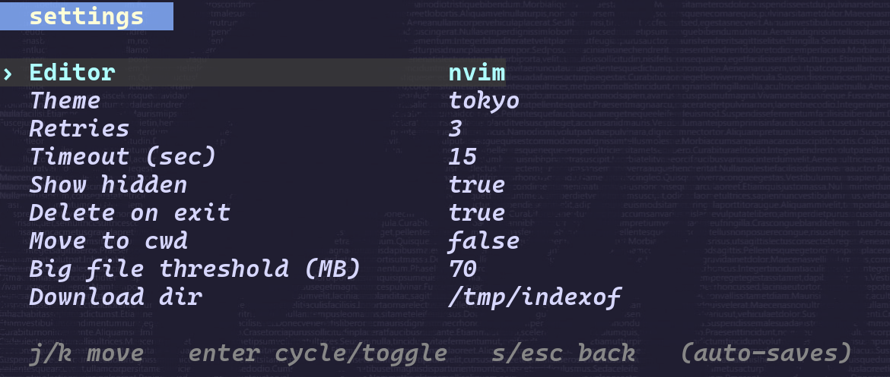
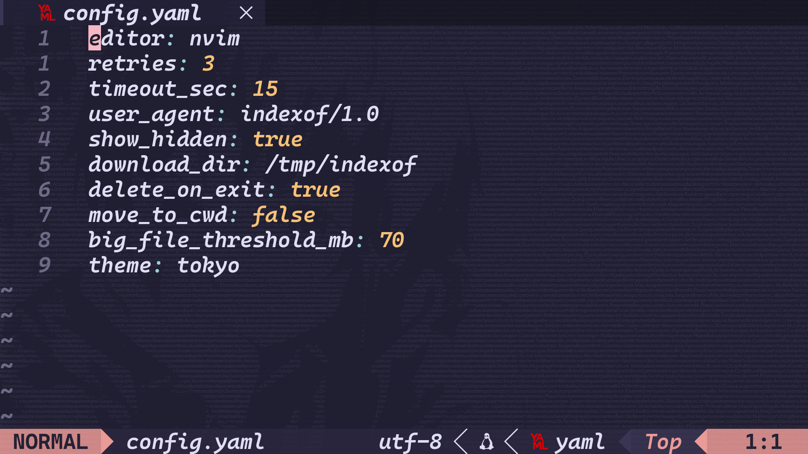

# Config

[readme](../README.md) · [screenshots](showcase.md) · [usage](usage.md)

indexof creates `~/.config/indexof/config.yaml` on the first run. settings changed in the app save to that same file.

## Settings

[](images/settings.png)

press `s` to open settings. move with `j` / `k` or the arrows, then use `enter` or `l` to cycle an option. `s`, `esc`, or `q` goes back.

the download directory is shown here but you need to edit it in the config file. the user-agent is only available in the file too.

## Config file

[](images/configuration-file.png)

this is a custom config. it uses neovim, the `tokyo` theme, `/tmp/indexof` for downloads, and a 70 mb file-size threshold. delete-on-exit is enabled, so files recorded as downloaded or opened during the session get cleaned up when you quit.

the `user_agent: indexof/1.0` value shown here is also custom. the defaults are below.

## Defaults

```yaml
editor: nvim
retries: 3
timeout_sec: 15
user_agent: github.com/erdajt/indexof/1.0
show_hidden: true
download_dir: /tmp/indexof
delete_on_exit: true
move_to_cwd: false
big_file_threshold_mb: 50
theme: default
```

the temporary directory depends on your system. `/tmp/indexof` is the usual linux path.

| option | what it does |
| --- | --- |
| `editor` | executable used to open a file; it needs to be on `PATH` |
| `retries` | number of attempts when fetching a listing; the panel cycles from 1 to 10 |
| `timeout_sec` | timeout for fetching a listing; the panel uses 5-second steps |
| `user_agent` | user-agent header sent with requests |
| `show_hidden` | include hidden entries in listings |
| `download_dir` | download folder when `move_to_cwd` is false |
| `delete_on_exit` | clean up files recorded as downloaded or opened during the session |
| `move_to_cwd` | use the current directory for downloads |
| `big_file_threshold_mb` | ask before downloading a file whose reported size exceeds this value |
| `theme` | colors used by the app |

## Applying changes

restart indexof after editing the file manually. in the settings panel, theme changes show up immediately. reload a listing after changing hidden-file visibility. timeout changes apply to the next listing request; retry changes need a restart.

## Editor

the panel cycles through `nvim`, `vim`, `nano`, `code`, and `hx`. you can put another executable in the config file. use a name or path, not a command with arguments.

indexof waits for the editor process to exit before returning to the listing. if your editor launches a separate process and exits straight away, use a wrapper that waits for it.

## Themes

`default` · `tokyo` · `catppuccin` · `nord` · `gruvbox` · `dracula`

select the theme in settings and press `enter` to cycle. terminal fonts, wallpaper, transparency, and editor colors come from your own setup.

## Keeping files

to download into the current directory and keep the files:

```yaml
move_to_cwd: true
delete_on_exit: false
```

you can also use `c` and `K` in the browser. the footer should show `cwd` and `del:off`.

changing the destination doesn't disable cleanup. with delete-on-exit enabled, an existing local file opened through indexof can also be deleted when you quit.
