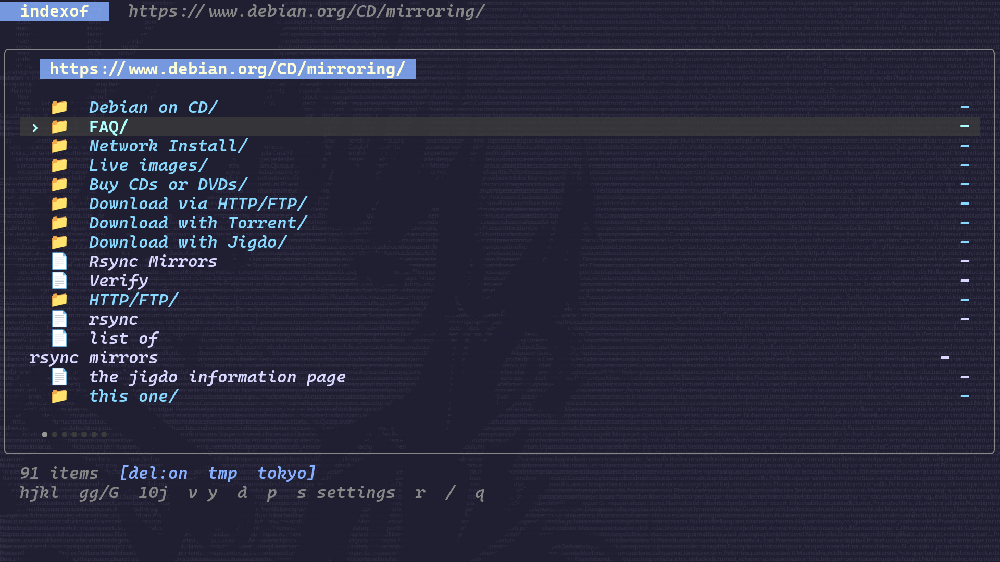
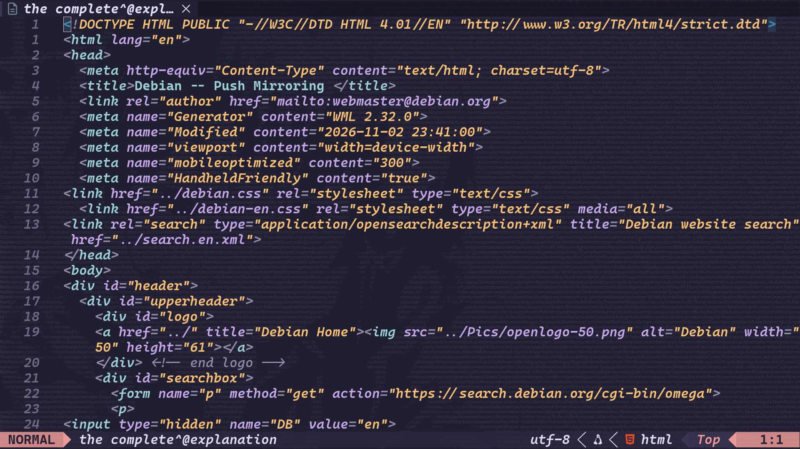
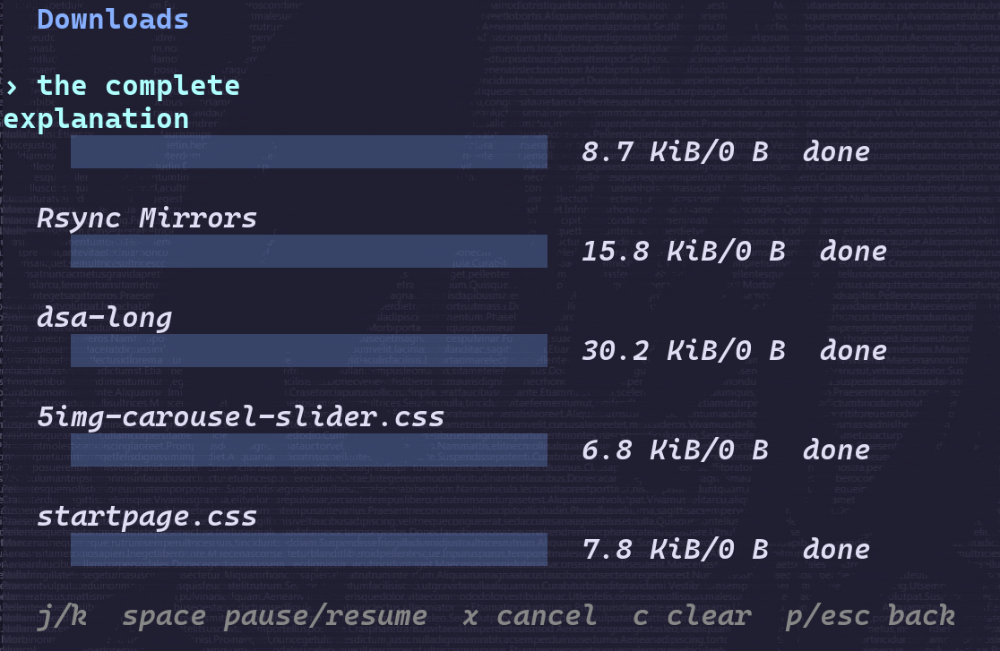
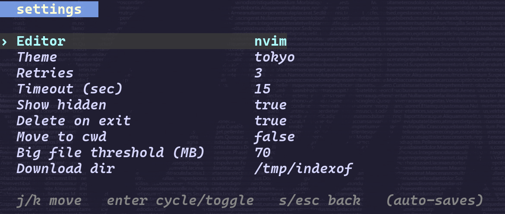
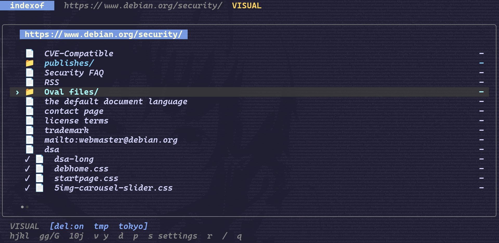

# Screenshots

[readme](../README.md) · [usage](usage.md) · [config](configuration.md)

some screenshots of indexof browsing debian pages. click an image for the full size.

## Browsing

`j` / `k` to move, `enter` to follow a directory, `h` to go back. the footer shows the download destination, cleanup setting, and theme.

## Editor

press `enter` on a file to download it and open it in your editor. this is neovim. close it to return to indexof.

## Downloads

`d` starts a download. `p` opens this view. these five jobs are done; running jobs show their progress here. you can pause, resume, or cancel them and keep browsing.

`0 B` on the right means the total size wasn't known. the number on the left is what was actually downloaded.

## Settings

press `s`, choose an option with `j` / `k`, and hit `enter` to change it. changes save automatically. this screenshot has a 70 mb threshold; the default is 50 mb.

## Visual selection

press `v`, move to select a range, then `y` to copy the urls. `esc` cancels. the checkmarks next to files mean they're already downloaded.

## Clipboard

after copying, indexof reports the number of urls and goes back to normal mode. the clipboard needs to be available in your terminal session.

the screenshots use `tokyo`. the font, background, and transparency are from the terminal setup.
