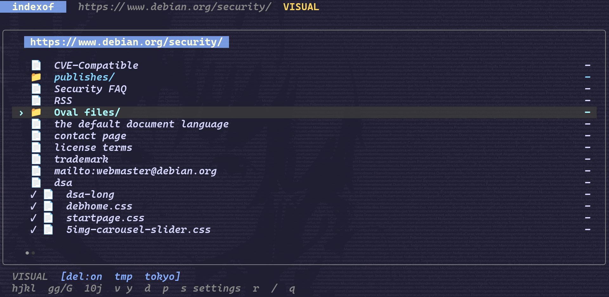
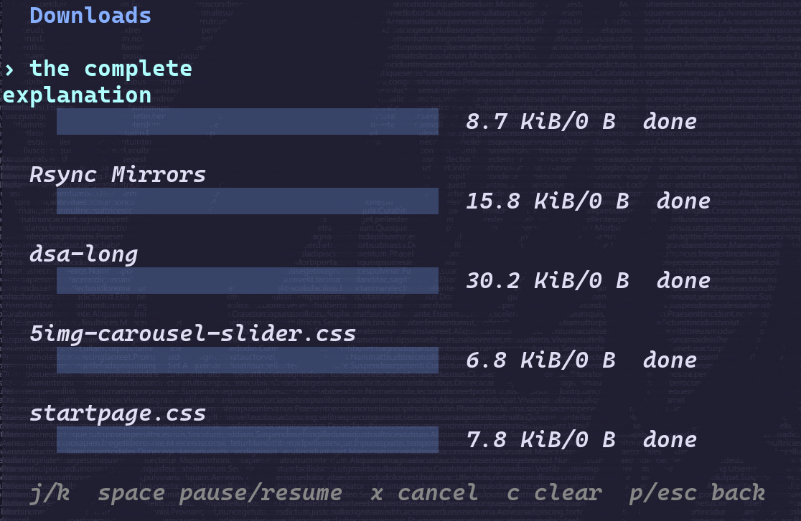

# Usage

[readme](../README.md) · [screenshots](showcase.md) · [config](configuration.md)

## Starting

```sh
indexof https://www.debian.org/CD/mirroring/
```

use `./indexof` if you're running a local build. indexof reads links from the page and shows file sizes when they're available. no parseable links means an empty listing; failed requests show an error.

## Keys

| key | action |
| --- | --- |
| `j` / `k`, `↓` / `↑` | down / up |
| `10j`, `5k` | move by a count |
| `l`, `→`, `enter` | enter a directory or open a file |
| `h`, `←`, `backspace` | go back through directories you've visited |
| `G` / `$` | last item |
| `v`, move, `y` | select a range and copy its urls |
| `d` | download without opening |
| `p` | downloads |
| `s` | settings |
| `c` | switch between the configured download folder and the current directory |
| `K` | toggle delete-on-exit |
| `r` / `q` | reload / quit |

in downloads: `space` pauses or resumes, `x` cancels, `c` clears finished jobs, and `p` or `esc` goes back.

if you wanna keep your downloads, turn delete-on-exit off with `K`. switching the destination with `c` doesn't turn cleanup off.

`h` goes back through the directories you've visited in this session. it doesn't guess the parent of the url you started with.

## Copying urls

1. move to the first item.
2. press `v`.
3. move up or down to select the range. counts work here too.
4. press `y` to copy the urls, one per line.

`esc` cancels. copying returns you to normal mode. the system clipboard needs to be available to your terminal.

[](images/visual-mode.png)

## Opening files

`d` downloads a file in the background. `enter` or `l` downloads it and opens it in your editor when it's done. close the editor to return to the listing.

if a nonempty file is already at the destination, indexof uses that copy. downloaded files get a checkmark in the listing. files are saved using their base name.

if a file's reported size is over the configured threshold, you'll get a confirmation prompt. `y` or `enter` continues; `n` or `esc` cancels. this check can't apply to files with unknown sizes.

## Downloads

[](images/downloads.png)

press `p` to open downloads.

| key | action |
| --- | --- |
| `j` / `k`, `↓` / `↑` | select a job |
| `space` | pause or resume |
| `x` | cancel |
| `c` | clear completed, failed, and cancelled jobs |
| `p` / `esc` | back to browsing |

resume uses http range requests when the server supports them. progress shows bytes downloaded and the total if it's known. an unknown total may show as `0 B`.

clearing a job removes it from this list. it doesn't delete the file.

## Download location and cleanup

downloads go to an `indexof` folder in the system's temporary directory by default, usually `/tmp/indexof` on linux.

press `c` in the browser to switch between that configured folder and the current directory. press `K` to toggle delete-on-exit. both settings save automatically.

delete-on-exit removes files recorded as downloaded or opened during the session. that can include an existing file you opened through indexof. turn it off if you want to keep them.

## Status bar

| indicator | meaning |
| --- | --- |
| `del:on` / `del:off` | cleanup enabled / disabled |
| `tmp` | using the configured download folder |
| `cwd` | using the current directory |
| `tokyo`, etc. | selected theme |
| `VISUAL` | selecting urls |

see [config](configuration.md) for all settings.
